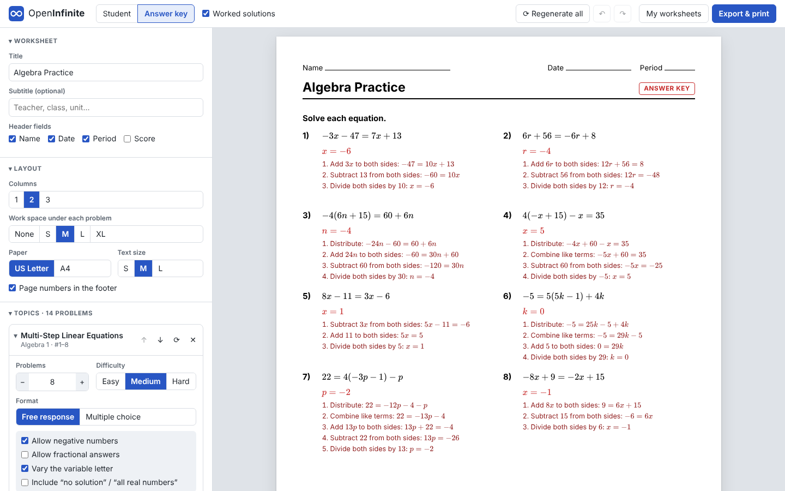

# OpenInfinite

An open-source, self-hostable generator of printable math worksheets with answer keys and worked solutions. It covers the same ground as Kuta Software's Infinite series: Pre-Algebra, Algebra 1 & 2, Geometry, Precalculus and Calculus.

Everything happens **in the browser**: problem generation, step-by-step solutions, figures, page layout and PDF export. The server only hands out static files, so a Raspberry Pi running nginx is plenty. This repository is also a ready-to-install **YunoHost package**.



## Features

| Area | What you get |
| --- | --- |
| **Topics** | 266 topic generators in 7 subjects — Pre-Algebra, Algebra 1, Algebra 2, Geometry, Trigonometry, Precalculus and Calculus — grouped by category (see below). Each has Easy / Medium / Hard tiers and its own options, e.g. integer vs. fractional answers, negative numbers, rounding vs. exact (radical/π) form, units, special cases. |
| **Formats** | Free response or multiple choice. Distractors are built from typical mistakes (sign errors, forgetting to distribute, wrong formula…). |
| **Layout** | 1, 2 or 3 columns; work space under each problem (none → XL); Name / Date / Period / Score fields; title and subtitle; US Letter or A4; text size; page numbers. |
| **Editing** | Regenerate everything (new seed) or a single problem; reorder by drag-and-drop or ↑/↓; edit any question, answer, choice or solution step by hand (LaTeX between `$…$`); delete; undo/redo. |
| **Answer key** | One click between the student sheet and the key: answers in red, the correct choice circled, optional worked solutions, solved graphs/figures (number lines, transformed triangles). |
| **Export** | Browser printing with exact page breaks and no UI chrome; client-side **PDF** (jsPDF + html2canvas); **LaTeX** (.tex with TikZ figures, compiles with pdflatex); **JSON** worksheet files. |
| **Storage** | Autosave plus a "My worksheets" library in the browser (localStorage). JSON files move worksheets between devices. Nothing is stored on the server. |
| **Offline** | A service worker caches the app shell, so it keeps working without a network once loaded. |

### Topics

Grouped by subject and category, as in the topic picker. Generated with `npx vite-node build/topic-table.ts` (in `app/`).

<details><summary><b>Pre-Algebra</b> — 27 topics</summary>

- **Integers and Order of Operations:** Adding and Subtracting Integers · Multiplying and Dividing Integers · Absolute Value · Order of Operations · Evaluating Expressions
- **Number Theory:** Divisibility and Prime Factorization · Greatest Common Factor and Least Common Multiple
- **Fractions, Decimals and Percents:** Simplifying Fractions · Operations with Fractions · Operations with Decimals · Fractions, Decimals and Percents
- **Ratios, Rates and Percents:** Ratios and Unit Rates · Solving Proportions · Percent Problems · Percent of Change, Markups, Discounts, Tax and Tips · Simple Interest
- **Exponents and Roots:** Exponents · Scientific Notation · Square Roots
- **Equations and Inequalities:** One-Step Equations · Two-Step Equations · Multi-Step Equations · One-Step and Two-Step Inequalities · Writing Expressions and Equations
- **Statistics:** Mean, Median, Mode and Range
- **Graphing:** Points in the Coordinate Plane · Plotting Points

</details>

<details><summary><b>Algebra 1</b> — 30 topics</summary>

- **Beginning Algebra:** Order of Operations · Simplifying Algebraic Expressions
- **Equations and Inequalities:** One-Step Equations · Multi-Step Equations · Work Word Problems · Distance-Rate-Time Word Problems · Mixture Word Problems · Absolute Value Equations · Multi-Step Inequalities · Compound Inequalities · Absolute Value Inequalities
- **Relations and Introduction to Functions:** Discrete Relations · Continuous Relations · Evaluating Functions
- **Linear Relations and Functions:** Finding Slope · Graphing Linear Equations · Writing Linear Equations · Graphing Absolute Value Equations · Graphing Linear Inequalities · Direct and Inverse Variation
- **Systems of Equations and Inequalities:** Graphing Systems of Linear Inequalities · Solving Systems by Graphing · Solving Systems by Elimination · Solving Systems by Substitution · Systems of Equations Word Problems · Systems of Linear Equations
- **Polynomials:** Adding, Subtracting & Multiplying Polynomials
- **Factoring:** Factoring Polynomials
- **Exponents:** Properties of Exponents
- **Radical Expressions:** Simplifying Radicals

</details>

<details><summary><b>Algebra 2</b> — 104 topics</summary>

- **Systems of Equations and Inequalities:** Points in Three Dimensions · Planes in Three Dimensions · Systems of Three Variables
- **Matrices:** Adding, Subtracting and Multiplying Matrices · Determinants · Inverse Matrices · Cramer's Rule · Matrix Equations · Geometric Transformations with Matrices · Matrix Operations
- **Complex Numbers:** Operations with Complex Numbers · Graphing Complex Numbers · Absolute Value of Complex Numbers · Rationalizing Denominators
- **Quadratic Functions and Inequalities:** Graphing Quadratic Functions · Graphing Quadratic Inequalities · Factoring Quadratic Expressions · Factoring Special Case Quadratic Expressions · Solving Equations by Taking Square Roots · Solving Equations by Factoring · Completing the Square · Solving Equations by Completing the Square · Solving Equations with the Quadratic Formula · The Discriminant
- **General Functions:** Evaluating Functions · Function Operations · Inverse Functions
- **Polynomial Functions:** Naming Polynomials · Adding and Subtracting Polynomials · Multiplying Polynomials · Multiplying Special Cases · The Binomial Theorem · Dividing Polynomials · Factoring by Grouping · Factoring Sums and Differences of Cubes · Factoring Quadratic Form · Factoring All Techniques · The Remainder Theorem · Writing Polynomial Functions · Conjugate Roots: Factoring · Conjugate Roots: Writing Functions · Descartes' Rule of Signs · The Rational Zero Theorem · The Fundamental Theorem of Algebra · Solving Polynomial Equations · End Behavior of Polynomials · Graphing Polynomial Functions
- **Radical Functions and Rational Exponents:** Simplifying Radicals · Adding and Subtracting Radical Expressions · Multiplying Radical Expressions · Dividing Radical Expressions · Radicals and Rational Exponents · Evaluating Rational Exponents · Properties of Rational Exponents · Radical Equations · Rational Exponent Equations · Graphing Radical Functions · Domain and Range of Radical Functions
- **Rational Expressions:** Graphing Rational Functions · Simplifying Rational Expressions · Multiplying and Dividing Rational Expressions · Adding and Subtracting Rational Expressions · Complex Fractions · Solving Rational Equations
- **Conic Sections:** Properties of Parabolas · Writing Equations of Parabolas · Graphing Circles · Writing Equations of Circles · Graphing Ellipses · Writing Equations of Ellipses · Graphing Hyperbolas · Writing Equations of Hyperbolas · Classifying Conic Sections · Systems of Quadratic Equations
- **Exponential and Logarithmic Functions:** Graphing Exponential Functions · Exponential Equations Not Requiring Logarithms · Exponents and Logarithms · Evaluating Logarithms · Logarithms and Exponents as Inverses · Properties of Logarithms · Writing Logs in Terms of Others · Exponential Equations Requiring Logarithms · Inverses of Exponential and Logarithmic Functions · Logarithmic Equations (Simple) · Logarithmic Equations (Hard) · Graphing Logarithmic Functions · Discrete Exponential Growth and Decay Word Problems · Continuous Exponential Growth and Decay Word Problems
- **Sequences and Series:** General Sequences · Arithmetic Sequences · Geometric Sequences · Arithmetic and Geometric Mean · General Series · Arithmetic Series · Geometric Series
- **Probability and Statistics:** Sample Spaces and the Fundamental Counting Principle · Probability of Independent and Dependent Events, Word Problems · Probability of Independent and Dependent Events · Probability of Mutually Exclusive Events, Word Problems · Probability of Mutually Exclusive Events · Permutations · Combinations · Permutations vs. Combinations · Probability with Permutations and Combinations

</details>

<details><summary><b>Geometry</b> — 36 topics</summary>

- **Basics of Geometry:** Segment Addition Postulate · Distance, Midpoint & Slope · Midpoints and Missing Endpoints · Angle Addition Postulate · Classifying Angles · Angle Relationships
- **Parallel and Perpendicular Lines:** Parallel Lines and Transversals · Slopes of Parallel and Perpendicular Lines
- **Triangles:** Classifying Triangles · Triangle Angle Sum and Exterior Angles · Isosceles and Equilateral Triangles · Triangle Congruence (SSS, SAS, ASA, AAS, HL) · Triangle Inequalities · Midsegments of Triangles · Medians and Centroids
- **Right Triangles and Trigonometry:** The Pythagorean Theorem · Converse of the Pythagorean Theorem · Special Right Triangles · Right Triangle Trigonometry · Angles of Elevation and Depression
- **Similarity:** Similar Polygons · Similar Triangles and Triangle Proportionality
- **Polygons and Quadrilaterals:** Interior and Exterior Angles of Polygons · Properties of Parallelograms · Area & Perimeter
- **Circles:** Central Angles and Arc Measures · Arc Length · Area of Sectors · Inscribed Angles · Tangents to Circles · Angles of Chords, Secants and Tangents · Segment Lengths in Circles · Equations of Circles
- **Transformations:** Transformations
- **Solids:** Volume & Surface Area · Surface Area of Solids

</details>

<details><summary><b>Trigonometry</b> — 16 topics</summary>

- **Angles and Angle Measure:** Angles and Angle Measure · Converting Between Degrees and Radians · Degrees and Degrees-Minutes-Seconds · Coterminal Angles · Arc Length and Sector Area
- **Right Triangle Trigonometry:** Right Triangle Trig: Finding Ratios · Right Triangle Trig: Finding Angle Measures · Right Triangle Trig: Finding Angles and Sides
- **Trigonometric Functions:** Trig Functions of Any Angle · Graphing Trig Functions
- **Laws of Sines and Cosines:** The Law of Sines · The Law of Cosines · Area and Laws of Sines and Cosines
- **Trigonometric Identities and Equations:** Angle Sum and Difference Identities · Double-Angle and Half-Angle Identities · Solving Trigonometric Equations

</details>

<details><summary><b>Precalculus</b> — 20 topics</summary>

- **Functions:** Domain and Range · Even and Odd Functions · Transformations of Functions · Evaluating Piecewise Functions · Graphing Piecewise Functions · Composition of Functions
- **Polynomial and Rational Functions:** Graphing Rational Functions · Partial Fraction Decomposition · Polynomial and Rational Inequalities
- **Vectors:** Vectors · Dot Product and Angle Between Vectors
- **Polar Coordinates and Complex Numbers:** Converting Polar and Rectangular Coordinates · Converting Polar and Rectangular Equations · Graphing Polar Equations · Trigonometric Form and De Moivre's Theorem
- **Parametric Equations:** Eliminating the Parameter · Graphing Parametric Equations
- **Sequences and Series:** Arithmetic & Geometric Sequences · Sigma Notation and Summation Formulas
- **Limits:** Limits from Graphs and Tables

</details>

<details><summary><b>Calculus</b> — 33 topics</summary>

- **Limits and Continuity:** Evaluating Limits · Limits at Infinity · One-Sided Limits · Special Trigonometric Limits · Continuity
- **Differentiation:** Definition of the Derivative · Differentiation Rules · The Product Rule · The Quotient Rule · The Chain Rule · Derivatives of Trigonometric Functions · Derivatives of Exponential and Logarithmic Functions · Derivatives of Inverse Trigonometric Functions · Implicit Differentiation · Higher-Order Derivatives
- **Applications of Differentiation:** Tangent and Normal Lines · Related Rates · Critical Points and Extrema · Concavity and Points of Inflection · Mean Value Theorem and Rolle's Theorem · Motion Along a Line · L'Hôpital's Rule · Optimization
- **Integration:** Riemann Sums · Integration · Definite Integrals · Integration by Substitution · Integration by Parts · Integrals of Trigonometric and Exponential Functions · The Fundamental Theorem of Calculus · Average Value of a Function
- **Applications of Integration:** Area Between Curves · Volumes of Solids of Revolution

</details>

<!-- 266 topics in total -->

## How it works

```
app/src/engine/          pure TypeScript, no DOM: runs in browsers and in the test-suite
  types.ts               TopicGenerator / ProblemContent contracts
  rng.ts                 seeded PRNG: every problem keeps the 32-bit seed it came from
  fraction.ts            exact rational arithmetic (answer keys never see floating-point drift)
  polynomial.ts, radical.ts, tex.ts
  diagram.ts             figures as primitives → SVG on screen, TikZ in LaTeX
  worksheet.ts           sections, seeds, deduplication, multiple-choice assembly
  topics/<subject>/*.ts  topic generators; every `export const x = defineTopic(...)` is picked up automatically
  topics/packs/*.ts      curriculum order of the topic picker (optional: unlisted topics are appended)
  export/                JSON and LaTeX
app/src/components/      React UI; worksheet/Worksheet.tsx paginates into real pages

manifest.toml, conf/, scripts/, doc/, tests.toml   the YunoHost package (repository root)
tools/                   release archive, manifest sync, nginx test harness
```

A topic generator is a pure function of a seeded RNG, a difficulty and its options:

```ts
export interface TopicGenerator {
  id: string;                    // saved in worksheet files
  subject: SubjectId;
  title: string;
  description: string;
  instruction: string | ((options: OptionValues) => string);   // "Solve each equation."
  options: readonly OptionDef[]; // checkboxes / selects shown in the UI
  multipleChoice: boolean;       // true when generate() always returns ≥ 3 distractors
  defaultCount: number;
  generate(ctx: { rng: Rng; difficulty: Difficulty; options: OptionValues }): ProblemContent;
}

export interface ProblemContent {
  question: RichText;            // text with inline LaTeX: "Solve $2x + 3 = 7$."
  answer: RichText;
  steps?: RichText[];            // worked solution, one line per step
  distractors?: RichText[];      // wrong answers for multiple choice
  diagram?: Diagram;             // figure for the question
  answerDiagram?: Diagram;       // figure for the key (e.g. a graphed solution)
  check?: Record<string, unknown>; // machine-checkable facts for the tests
}
```

Generators build each problem backwards from its answer. For example, `topics/algebra1/linear-multistep.ts` picks an equation shape and its coefficients, picks the solution (an integer, or a fraction whose denominator divides the net coefficient), then solves for the one remaining constant. Rejection sampling enforces the options: signs, sizes, and "no solution / all real numbers" cases. `topics/algebra2/quadratic-formula.ts` builds rational roots from linear factors, or draws coefficients with the right discriminant. It then simplifies `(-b ± √D) / 2a` completely (radical, common factor, sign, `i` for complex roots).

**Pagination.** Every block (header, section heading, row of problems) is first rendered into an invisible column at the page's content width. The measured heights are then packed into fixed-size pages. The screen preview, browser printing and the PDF export all use these same pages, so page breaks always match.

**PDF.** Each page is rasterised by html2canvas at 2× and placed full-bleed on a jsPDF page. Both libraries are loaded only when you export. For vector output, use *Print → Save as PDF* or the LaTeX export.

## How the answer keys are verified

Answer keys are the product, so they are tested end to end against the *rendered* strings, not the generator's internal values:

- `tests/evaluator.ts` is a small evaluator for the LaTeX subset the generators emit (fractions, radicals, powers, `±`, trig, `e`, `ln`, absolute values, complex numbers).
- `tests/verify.ts` checks every problem kind independently. Solutions are substituted back into the question. Factorisations and simplifications are compared numerically at sample points. Derivatives are checked by numeric differentiation and integrals by Simpson's rule. Areas come from the shoelace formula on the figure's vertices. Transformations are re-applied with rotation matrices.
- `tests/fuzz/<pack>.test.ts` (one file per topic pack, run in parallel) fuzzes **every topic × difficulty × option variant** (120 seeds each by default; `FUZZ_SEEDS=600 npm test` for a deep run). It also renders every question, answer, step and distractor with KaTeX (any parse error fails the test), checks that multiple-choice options are distinct, and rejects formatting slips such as `+ -3`, `1x`, `x^{1}` or `· -2`.
- `e2e/smoke.mjs` drives the production build in headless Chromium: it adds all topics, paginates, edits, drags and drops, undoes, prints, exports PDF/LaTeX/JSON, re-imports, reloads, and checks the phone layout.

The LaTeX export has also been compiled with pdflatex for every topic, difficulty and format.

## Development

Requires Node.js 22.12 or newer (CI uses 22.22).

```sh
cd app
npm ci
npm run dev          # http://localhost:5173
npm test             # unit tests + answer-key fuzzing
npm run typecheck
npm run build        # → app/dist (static files)
npm run e2e          # end-to-end test of app/dist in headless Chromium (set CHROMIUM_PATH if needed)
```

To add a topic, create `app/src/engine/topics/<subject>/<name>.ts` exporting `defineTopic({...})` with a `category`, list it in its pack under `topics/packs/` (which fixes the order in the picker), and give its problems a `check` that `tests/verify.ts` or a pack verifier in `tests/verifiers/<pack>.ts` can verify. `PACK=<pack> npx vitest run tests/topics.test.ts` fuzzes one pack; `npm test` runs everything.

## Self-hosting

### YunoHost

The repository root is the YunoHost package (packaging v2, helpers 2.1, YunoHost ≥ 12). Install it from the `main` branch:

```sh
sudo yunohost app install https://github.com/GZPlaz/open-infinite_ynh/tree/main
```

or paste `https://github.com/GZPlaz/open-infinite_ynh/tree/main` into *Applications → Install → Install custom app* in the webadmin. You will be asked for a domain, a path (default `/openinfinite`), who may access it (default: visitors) and the default paper size for new worksheets.

> **Branch names.** YunoHost reads only the part of the default branch name before the first `/`, so a repository whose default branch is e.g. `claude/some-feature` fails with *"Could not fetch source files, is the URL correct?"*. Install from `…/tree/main` (as above), or make `main` the default branch on GitHub so the plain repository URL works too.

| Script | Action |
| --- | --- |
| `install` | Downloads the pre-built release archive pinned in `manifest.toml` (sha256-checked), unpacks it to `/var/www/$app`, writes `config.json` from the settings, sets permissions (`$app:www-data`, 750/640) and adds the nginx config. No Node.js, no build. |
| `upgrade` | Fills in settings introduced by newer versions (`ynh_app_setting_set`), replaces the files with the new release (`--full_replace`, since bundle names are content-hashed), rewrites `config.json` and the nginx config. |
| `backup` / `restore` | The app directory and its nginx config. There is no server-side user data. |
| `change_url` | Moves the nginx config. Asset URLs are relative and nginx injects `<base href>` for the new path, so no files change. |
| `remove` | Removes the nginx config; YunoHost removes the directory, system user and permissions (manifest resources). |

`conf/nginx.conf` serves the app with an SPA fallback for client-side routes; a `<base href="__PATH__/">` injected with `sub_filter`, so deep links resolve assets from the app root; `Cache-Control: no-cache` on `index.html`, `sw.js` and `config.json`; one-year `immutable` caching for the content-hashed bundles and KaTeX fonts; and `gzip_static on`, so the `.gz` files produced at build time are served instead of compressing on every request.

YunoHost packaging v2 reads `manifest.toml`. `manifest.json` is an exact JSON mirror of it, generated by `tools/sync_manifest.py` (CI checks that they match). Edit the TOML and regenerate the JSON. Administration notes are in [doc/ADMIN.md](doc/ADMIN.md).

Package tests:

- `tools/test-nginx.sh /openinfinite` and `tools/test-nginx.sh /` render `conf/nginx.conf` the way `ynh_config_add_nginx` does, serve the real build through nginx and check redirects, the base tag, deep links, `gzip_static`, cache headers and 404s (runs in CI).
- The scripts are linted with shellcheck in CI.
- `tests.toml` declares the default [package_check](https://github.com/YunoHost/package_check) scenarios with the non-default A4 paper size.

### Any static web server

`app/dist` (or a release archive) is a set of static files that works from any sub-path. For client-side routing on deep links, serve `index.html` for unknown paths and add `<base href="/your/path/">`. The YunoHost nginx config does both and is a good template.

## Releasing

1. Bump `version` in `app/package.json` and push a tag `vX.Y.Z`, or create the release in the GitHub UI (which pushes the tag).
2. `.github/workflows/release.yml` builds a reproducible `openinfinite-X.Y.Z.tar.gz` and attaches it to the release, creating the release if needed. It then points `manifest.toml` (and `manifest.json`) at the new archive and its sha256, on the default branch.

If a release exists without its archive, run *Actions → Release → Run workflow* with its tag. `tools/build-release.sh --update-manifest` does the same build locally. The archive is byte-for-byte reproducible, so CI and local builds of the same commit share a checksum. The manifest also declares `autoupdate.strategy = "latest_github_release"` for the YunoHost catalog's auto-updater.

## License

MIT — see [LICENSE](LICENSE). Kuta Software and Infinite Algebra are trademarks of their owners; OpenInfinite is an independent project and is not affiliated with them.
